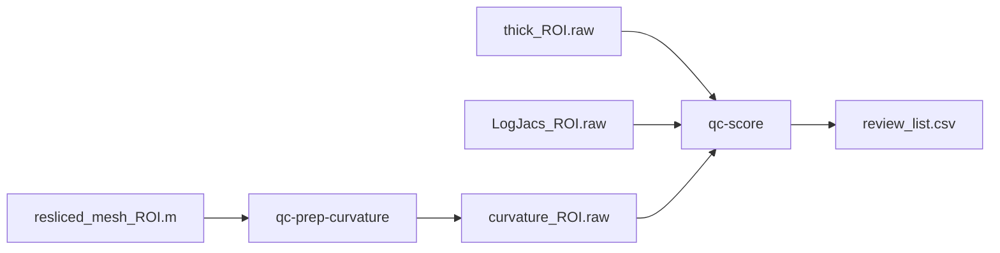

# enigma-shape-qc

Quality control for **ENIGMA subcortical shape** features (LAMCIG lab).

Intended GitHub home: [LAMCIG-lab/enigma-shape-qc](https://github.com/LAMCIG-lab/enigma-shape-qc).  
This folder is the software drop (`QC_ML_submit/`). Cluster data stays out of git.

Default model channels: **thickness + log-Jacobian + mean curvature**.  
Stock ENIGMA-Shape does not write curvature; this package generates `curvature_<roi>.raw` from `resliced_mesh_<roi>.m`.

## Install

```bash
git clone https://github.com/LAMCIG-lab/enigma-shape-qc
cd enigma-shape-qc
pip install -e ".[dev]"
```

`qc-prep-curvature` needs the ENIGMA-Shape `ccbbm` binary (`export CCBBM=/path/to/ccbbm`).

## Score a Shape tree (technicians)

Each subject directory must already contain `resliced_mesh_<roi>.m`, `thick_<roi>.raw`, and `LogJacs_<roi>.raw`.

```bash
qc-prep-curvature --shape-root /path/to/Shape_output
qc-score --shape-root /path/to/Shape_output --out-dir ./outputs/score --model /path/to/model_simple.joblib
```

Outputs: `inventory.csv`, and if `--model` is set, `predictions.csv` and `review_list.csv` (`P_fail`, `tau`, `flag`).  
`flag=1` means send to a human. This repo does **not** include trained `.joblib` weights.

Without a model, `qc-score` only writes the inventory (which files exist).

Sites with no meshes: `--features thick,logjac` or re-run ENIGMA-Shape. Do not zero-fill curvature.

## Tiny example (no ENIGMA data)

```bash
qc-prep --shape-root examples/tiny --rois 17 --labels examples/tiny/labels.csv --out /tmp/tiny_manifest.csv
qc-train --manifest /tmp/tiny_manifest.csv --out-dir /tmp/tiny_run --features thick,logjac,curv
qc-score --shape-root examples/tiny --rois 17 --model /tmp/tiny_run/model_simple.joblib --out-dir /tmp/tiny_score
qc-report --predictions /tmp/tiny_run/predictions.csv
```

`qc-train` here is a **scaler + logistic** so CI can run. The paper model is Kernel PCA + logistic (`configs/paper_l3_thick_logjac_curv.yaml`).

## Input → output



`curve_<roi>.ucf` is the medial curve. It is not used.

## Paper numbers (provisional)

Source run id: `curv_full_recall80` (21 ROIs × 5 seeds, recall floor 0.8).  
Macros below **zero-filled** curvature for 416 FBIRN/UCIS subjects. Camera-ready Table 1 is a retrain with `require_features: [thick, logjac, curv]`.

| Metric | thick+logjac+curv | ablation thick+logjac |
|--------|-------------------|------------------------|
| Fail recall | 0.798 | 0.777 |
| Flagged share | 0.318 | 0.326 |
| AUC | 0.845 | 0.826 |

See `paper/` and `configs/`.

## Repository layout

```
README.md
LICENSE
CITATION.cff
pyproject.toml
configs/          paper, ablation, score-only
docs/             technician + I/O
paper/            tables only (no models)
src/shapeqc/      library + CLI
examples/tiny/    2 synthetic subjects, ROI 17
tests/
extras/           GNN / intensity / unsupervised — not default
```

## Out of scope

FreeSurfer and ENIGMA-Shape Medial Demons. This package starts at a Shape subject folder.
